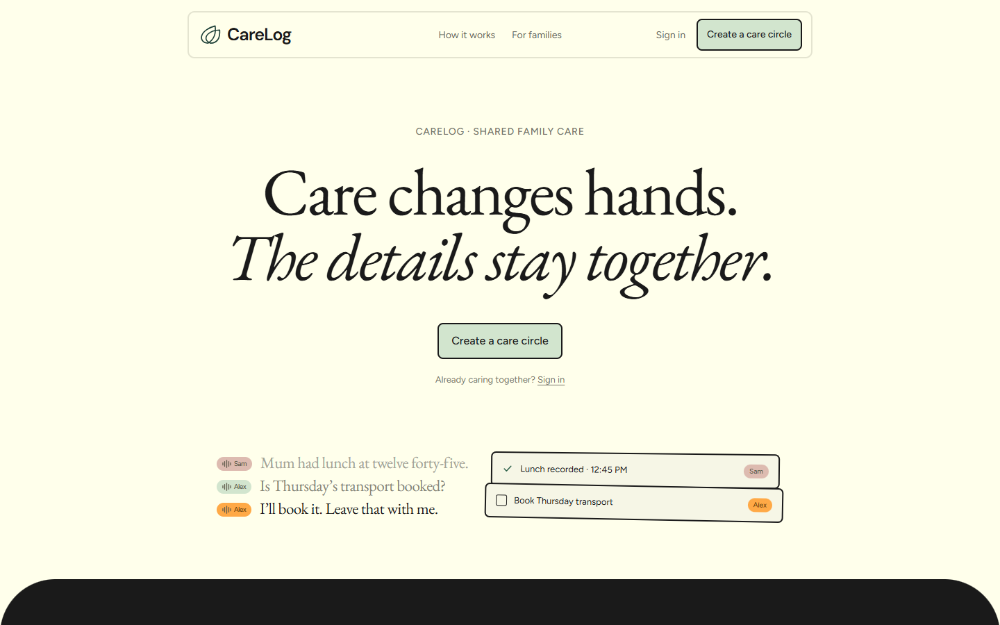
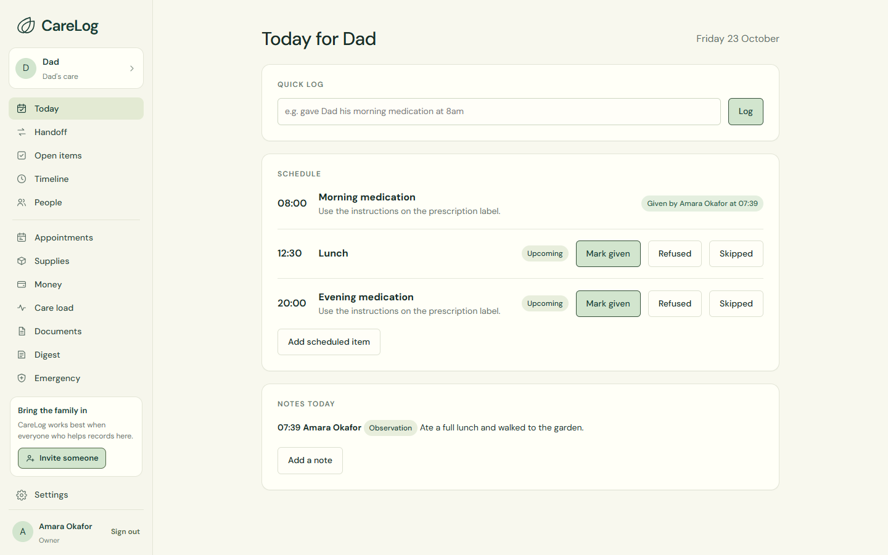
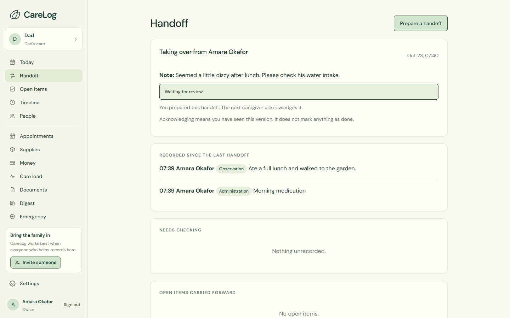
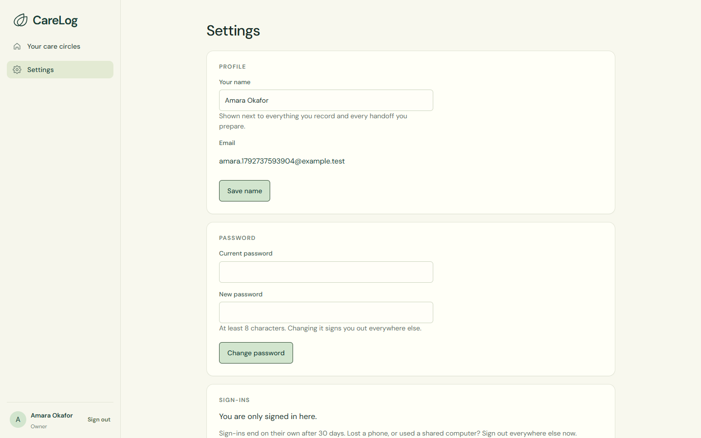

# CareLog

**One shared care record for families who take turns looking after someone.**

When care passes from one person to the next, the next person needs to know what happened, what still needs checking and which jobs are not finished. CareLog keeps all of that in one place, with every entry signed by the person who wrote it.

**Try it:** [carelog-sigma.vercel.app](https://carelog-sigma.vercel.app) · Create an account with made-up details. No email is sent.

Built for TestSprite Hackathon Season 4.



---

## Contents

1. [The problem](#the-problem)
2. [What CareLog does](#what-carelog-does)
3. [Screenshots](#screenshots)
4. [How it is tested](#how-it-is-tested)
5. [What the tests found](#what-the-tests-found)
6. [Run it on your computer](#run-it-on-your-computer)
7. [How the code is organised](#how-the-code-is-organised)
8. [Known limits](#known-limits)

---

## The problem

Three brothers and sisters share the care of their father. They talk in a group chat and a paper notebook. Nobody can say for sure whether Dad had his 2 pm tablets. Two people might each give a dose. A note about dizziness never reaches the next person. "Someone should book Thursday's transport" is said once and forgotten.

## What CareLog does

| Area | What you can do |
|---|---|
| **Today** | See the day's schedule. Mark a dose as given, refused or skipped. If someone already recorded it, CareLog shows who, instead of letting it be recorded twice. |
| **Quick log** | Type "gave Dad his morning medication at 8am" and it becomes the right record. |
| **Notes** | Add an observation, an incident, a meal or a visit. Mark a note as private if only family should see it. |
| **Handoff** | At the end of your shift, write a handoff. It lists what was recorded, what has no record yet, and every unfinished job. The next person reads it and confirms they have seen it. |
| **Open items** | Jobs stay on the list until someone writes down what was done. Reading a handoff does not tick them off. |
| **Timeline** | Every entry in order, newest first. If an entry is corrected, the original and the reason are kept. |
| **People** | Invite family, paid carers, a doctor (read only, for a set time) or a neighbour. Remove someone and they lose access straight away. |
| **Emergency** | Share a link with medicines, allergies and contacts. Private notes are never included. Switch the link off whenever you like. |
| **Money, appointments, supplies, documents** | Split shared costs to the cent, track who is taking each appointment, see when supplies run low, and keep key documents together. |
| **Settings** | Change your name and password, and sign out of every other browser. |

### What CareLog will not do

It records what people enter. It does not recommend doses, judge whether a dose is safe, diagnose anything, or replace a doctor or nurse. If nothing has been recorded, it says "no record". It never says a dose was missed, because it cannot know that.

## Screenshots

| Today | Handoff |
|---|---|
|  |  |

| Settings |  |
|---|---|
|  | |

## How it is tested

Tests run at three levels. The browser tests decide whether a change is allowed in.

### 1. TestSprite: 32 browser tests on every pull request

- Every pull request gets its own preview website on Vercel.
- When the preview is ready, the TestSprite GitHub App runs all 32 tests against it.
- The main branch only accepts a change when the **TestSprite V3** check passes. This applies to administrators too.

| Area | What the tests check |
|---|---|
| Accounts | Create an account, sign in, create a circle |
| Today | Record a dose, quick log, add a note and see it on the page |
| Handoff | Prepare a handoff, see what it includes, a second person reviews and confirms it |
| Open items | Add, take on, and close with an outcome |
| Timeline | Newest first, correct an entry and keep the history |
| People | Invite someone; remove someone and check they lose access |
| Emergency | Create, open and switch off a share link |
| Documents, appointments, supplies, care load, money, notes | The main action in each, with the result checked on screen |

Tests that change data start by creating their own care circle, so leftovers from earlier runs cannot confuse them. Tests that need two people create a second account inside the test.

### 2. Repository tests: `npm test` (41 tests)

These check rules a browser cannot easily reach. For example: two people recording the same dose at the same moment, someone removed from a circle trying to keep reading it, private notes leaking to the wrong role, money splits losing a cent, times shifting across time zones, and sign-ins ending after 30 days.

### 3. Browser journeys on your computer: `npm run test:browser` (7 journeys)

Every section of the app on phone, tablet and desktop sizes, plus inviting someone on the same device, settings, and the logo taking you back to the landing page.

## What the tests found

Every item below was a real problem in the app, found by a failing TestSprite test and fixed in code.

| # | What went wrong | What we changed | Pull request |
|---|---|---|---|
| 1 | Signing out on one browser signed you out everywhere | Sign-out now ends only that browser | [#4](https://github.com/IamHarrie-Labs/carelog/pull/4) |
| 2 | Restocking closed the refill job while stock was still low | The job closes only when stock is back above the low level | [#4](https://github.com/IamHarrie-Labs/carelog/pull/4) |
| 3 | A logged shift never appeared anywhere | Care load now lists each shift | [#4](https://github.com/IamHarrie-Labs/carelog/pull/4) |
| 4 | A 2 pm shift showed as 3 pm for people in another time zone | Times are read in the circle's time zone | [#2](https://github.com/IamHarrie-Labs/carelog/pull/2) |
| 5 | The word "null" appeared on the sign-in page | Removed | [#5](https://github.com/IamHarrie-Labs/carelog/pull/5) |
| 6 | A note saved from Today vanished from the page | Today lists the day's notes | [#5](https://github.com/IamHarrie-Labs/carelog/pull/5) |
| 7 | Invite links were easy to copy wrongly | Links use letters and numbers that cannot be mixed up | [#5](https://github.com/IamHarrie-Labs/carelog/pull/5) |
| 8 | A missing "acknowledge" button had no explanation | The page says who the handoff is for | [#5](https://github.com/IamHarrie-Labs/carelog/pull/5) |
| 9 | You could not invite the person sitting next to you | "Open the invite on this device" | [#5](https://github.com/IamHarrie-Labs/carelog/pull/5) |
| 10 | Pages got slower as a circle grew (a handoff took 127 database queries) | Records load in batches (a handoff now takes 10) | [#9](https://github.com/IamHarrie-Labs/carelog/pull/9) |

**PR #5** was the first change held by the gate: 28 of 32 tests passed, the merge was blocked, and after the fixes it passed 32 of 32. Every pull request since then has passed all 32 tests before merging.

## Run it on your computer

You need [Node.js](https://nodejs.org) 22.13 or newer.

```bash
npm install
npm run seed      # optional: adds a made-up example circle
npm start         # open http://localhost:3000
npm test          # repository tests
npm run test:browser   # browser journeys (uses Microsoft Edge; set PW_CHANNEL=chrome for Chrome)
```

### Put it online

CareLog runs on **Vercel** with a **Turso** database.

1. Create a Turso database and note its address and access token.
2. Import this repository into Vercel. Add `TURSO_DATABASE_URL` and `TURSO_AUTH_TOKEN`. `ANTHROPIC_API_KEY` is optional and only adds drafted handoff summaries.
3. In Vercel's project settings, turn off **Deployment Protection** for previews, so TestSprite can open them.

## How the code is organised

```
carelog/
├── public/        The website people see (no framework, plain JavaScript)
│   ├── app.js         Pages inside the app: Today, Handoff, People, Settings…
│   ├── more.js        Money, care load, appointments, supplies, documents
│   ├── reference-page.js   The landing page
│   └── ui.js          Shared helpers: forms, messages, dates
├── src/           The server
│   ├── app.js         Sign-in, circles, records, invites, settings
│   ├── core.js        The access check that runs on every request
│   ├── handoffs.js    Handoffs and their summaries
│   └── extras.js      Emergency links, money, supplies, care load
├── api/           How Vercel runs the server
├── test/          Repository tests and browser journeys
└── docs/          Requirements (PRD.md), screenshots and design notes
```

Everything people type is shown as plain text, never as code. Every button and field has a stable test name (`data-testid`), so tests do not break when the design changes.

## Known limits

- **Shared database.** Preview websites use the same database as the live site. Tests keep apart by making their own care circles, but their records still land in the live database.
- **Not yet tried by real caregivers.** The tests check that the app does what it was built to do. They cannot tell us whether a tired caregiver finds it easy at 2 am.
- **No push notifications yet.** A message when someone hands over to you, or when a dose has no record, would help. It needs permission prompts and personal settings that are not built yet.
- **Privacy.** Use made-up details in any public demo. Real health information needs a proper data-protection review before real families use this.

---

*Built by Stanley Nnaka with help from Claude Code and Codex. Fonts are self-hosted under their open licences (see `public/assets`).*
